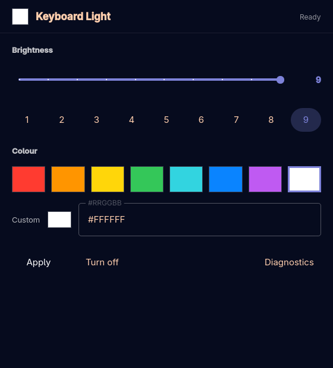

# kbdlight

Control the keyboard backlight on Clevo-based laptops (tested on **Axioo
Pongo 725**, Clevo NH5xR) from a small keyboard-driven window that follows
the Omarchy theme.



## What works

| Feature | Status |
|---|---|
| Brightness 0-9 (0 = off, 1 = dim, 9 = bright) | **works** |
| Turn off | **works** |
| Colour (RGB) | **works** — HSV picker, payload order is BRG, see below |

### About colour: the payload order is BRG, not RGB

The firmware exposes a colour command (`\_SB_.WMI_.SCMD`, id `0x67`, mode
`0xF`) that forwards three payload bytes to the embedded controller. The
payload is **not** in RGB order — the wiring on the Pongo 725 maps it as:

| Payload byte | Colour |
|---|---|
| A (bits 16-23) | **blue** |
| B (bits 8-15) | **red** |
| C (bits 0-7) | **green** |

So an RGB colour is rotated into BRG before it is sent. This is easy to get
wrong and obvious when you do: `#00FFFF` (cyan) sent as plain RGB lights
red+green and comes out **yellow**, which is exactly how the order was
identified on this machine.

Pick any colour with the HSV picker (saturation/value square plus a hue
strip); it previews live and writes to the hardware as you drag. Eight
presets are there for the common picks.

`kbdlight-ctl color <r> <g> <b>` takes plain RGB and does the rotation, so
the quirk lives in one place. The **Diagnostics** panel sends each payload
byte alone (`A -> blue`, `B -> red`, `C -> green`) so you can re-confirm it
on a different model.

## Build and install

```bash
./bin/build     # builds build/kbdlight and build/kbdlight-ctl
./bin/install   # needs sudo: helper is setuid root
```

The app then appears in the launcher as **Keyboard Light**.

## How it talks to the hardware

`kbdlight-ctl` is a small setuid-root helper that writes a single ACPI call:

```
\_SB_.WMI_.SCMD 0 0x67 <ARGS dword>
```

into `/proc/acpi/call`, which requires the `acpi_call` kernel module
(`pacman -S acpi_call-dkms`). The helper accepts only a fixed argument
vocabulary and never evaluates a shell string, so the setuid bit does not
widen the attack surface beyond "set the keyboard light".

The GUI never runs as root; it calls the helper and reports its exit status,
so a failure is shown in the window instead of being swallowed.

### ARGS encoding (from the DSDT)

| Bits | Meaning |
|---|---|
| 28-31 | mode: `0xD` brightness, `0xF` colour |
| 24-27 | zone: 0 = all |
| 16-23 | payload byte A |
| 8-15 | payload byte B |
| 0-7 | payload byte C |
| 12-15 | brightness nibble; **1 = brightest, 9 = dimmest**, `>= 0xA` = off |

The nibble runs opposite to the slider: the DSDT computes
`EC = 0xFF - nibble*0x19`, and a low EC value is a dim panel, so nibble 1 is
full brightness. `kbdlight-ctl brightness <1-9>` inverts it (`nibble =
10 - level`) so the UI reads the intuitive way, 1 = dim and 9 = bright.

## Shortcuts

| Key | Action |
|---|---|
| `Space` | Apply brightness and colour |
| `Q` | Quit |
| `?` | Show help |

## Layout

```
kbdlight.pro          qmake project
bin/build             qmake6 + make into build/
bin/install           installs binary, setuid helper, desktop entry, icon
src/main.cpp          app setup
src/backend.{h,cpp}   talks to the helper, owns state
src/theme.{h,cpp}     Omarchy accent + Hyprland rounding
src/kbdlight-ctl.c    setuid helper that writes the ACPI call
src/Main.qml          the window
pkgbuild/             .desktop and icon
```

## Licence

MIT
